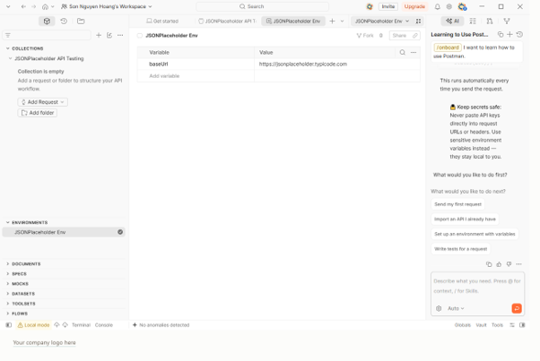
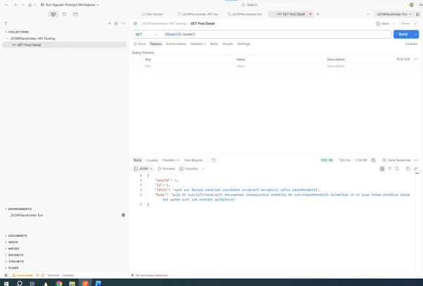

# BÁO CÁO BÀI TẬP KIỂM THỬ SOFTWARE: API TESTING VỚI POSTMAN

##  Tổng quan về Bài tập & Công cụ
Bài tập thực hành kiểm thử chức năng (Functional Testing) trên dịch vụ Mock REST API.

- **Mock API Service:** [JSONPlaceholder](https://jsonplaceholder.typicode.com/)
- **Base URL:** `https://jsonplaceholder.typicode.com`
- **Công cụ sử dụng:** Postman Desktop App (quản lý Environment Variables, Collections và viết Test Scripts tự động).

---

##  Kết quả Kiểm thử Chức năng với Postman

### Cấu hình Environment & Collection
Thiết lập Collection `JSONPlaceholder API Testing` cùng môi trường `JSONPlaceholder Env` chứa biến `baseUrl = https://jsonplaceholder.typicode.com`.



---

### Phương thức GET - Lấy thông tin bài viết (Read)
- **Endpoint:** `GET {{baseUrl}}/posts/1`
- **Trạng thái:** `200 OK`
- **Mô tả:** Nhận về đúng dữ liệu chi tiết bài viết có ID = 1 dưới dạng JSON.



---

### Phương thức POST - Tạo mới bài viết (Create)
- **Endpoint:** `POST {{baseUrl}}/posts`
- **Trạng thái:** `201 Created`
- **Body Request (raw JSON):**
  ```json
  {
    "title": "Bài viết thử nghiệm Postman",
    "body": "Nội dung thực hành kiểm thử API",
    "userId": 1
  }
  Mô tả: Hệ thống tiếp nhận thành công và trả về bài viết mới kèm ID hệ thống tự cấp là 101.
 ### Phương thức PUT & DELETE - Cập nhật và Xóa bài viết (Update & Delete)
 Endpoint PUT: PUT {{baseUrl}}/posts/1 $\rightarrow$ Trạng thái 200 OK (Cập nhật thành công thông tin tiêu đề và nội dung).
 Endpoint DELETE: DELETE {{baseUrl}}/posts/1 $\rightarrow$ Trạng thái 200 OK (Xóa thành công tài nguyên).
 ### Kiểm thử Tự động (Test Scripts)Thêm các câu lệnh kiểm thử tự động trong tab Scripts của Request GET:JavaScript
 // 1. Kiểm tra Status Code trả về đúng 200 OK
pm.test("Status code is 200 OK", function () {
    pm.response.to.have.status(200);
});

// 2. Kiểm tra thời gian phản hồi (Response Time) dưới 500ms
pm.test("Response time is less than 500ms", function () {
    pm.expect(pm.response.responseTime).to.be.below(500);
});

// 3. Kiểm tra dữ liệu JSON trả về đúng ID bài viết = 1
pm.test("Verify Post ID is 1", function () {
    var jsonData = pm.response.json();
    pm.expect(jsonData.id).to.eql(1);
});
Kết quả: Tất cả 3 bài test tự động đều đạt trạng thái PASSED.
### 4. Kết luận
Độ chính xác: API hoạt động đúng chuẩn kiến trúc RESTful (xử lý chính xác các phương thức CRUD GET, POST, PUT, DELETE).Hiệu năng cơ bản: Thời gian phản hồi của API cực kỳ nhanh (trung bình dưới 100ms), đáp ứng tốt tiêu chuẩn kỹ thuật (< 500ms).Tự động hóa: Hoàn thành thiết lập bộ script kiểm thử tự động trên Postman giúp xác định phản hồi hệ thống nhanh chóng.
